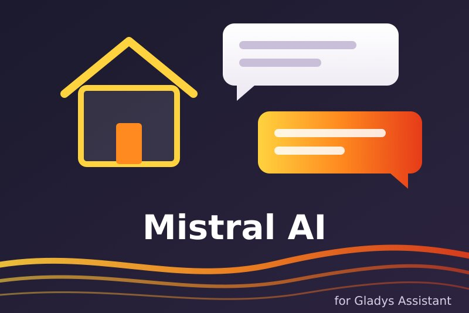
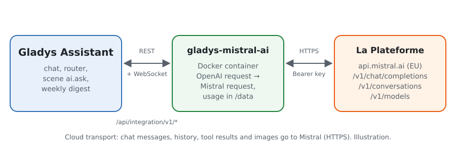
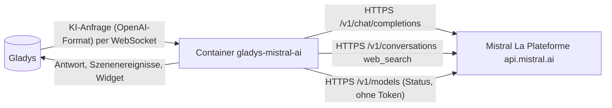
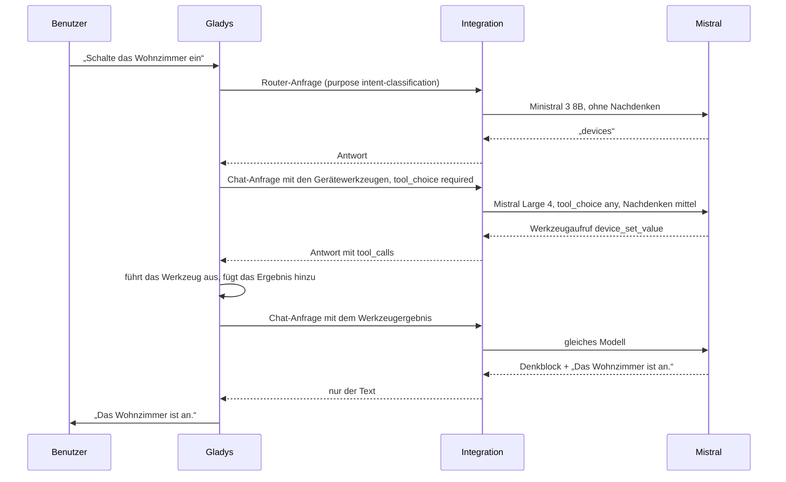
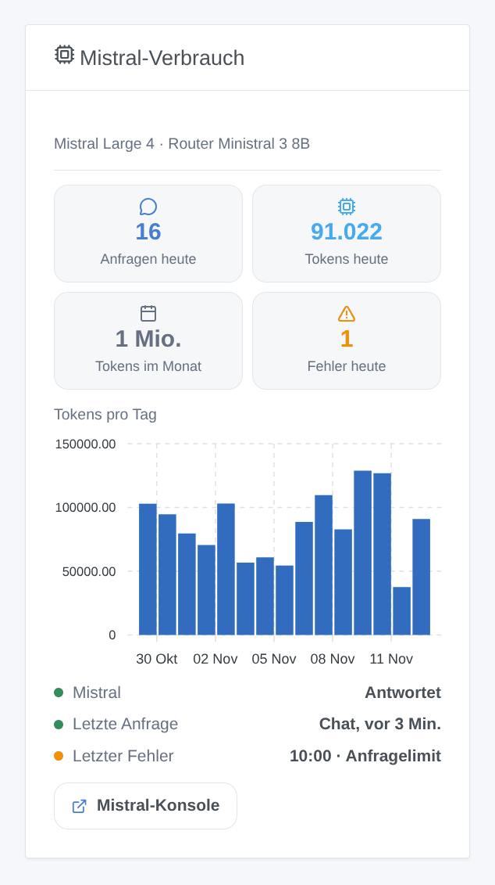

# Gladys Mistral AI

[English](README.md) · [Français](README.fr.md) · **Deutsch** · [Español](README.es.md)

[](LICENSE)
[](https://github.com/William-De71/gladys-mistral-ai/releases)
[](https://github.com/William-De71/gladys-mistral-ai/actions/workflows/release.yml)
[](https://gladysassistant.com)



Externe Integration für [Gladys Assistant](https://gladysassistant.com), die den Assistenten von Gladys mit **Mistral AI** betreibt, der KI aus Frankreich, über ihre offizielle API (La Plateforme, in Europa gehostet) und deinen eigenen API-Schlüssel. Sobald sie unter Einstellungen → Künstliche Intelligenz gewählt ist, beantwortet Mistral den Chat, steuert deine Geräte, erstellt Szenen, beantwortet die Szenenaktion „KI fragen“ und schreibt den Wochenrückblick — mit oder ohne Gladys-Plus-Konto.

Benutzerdokumentation: [English](docs/en.md) · [Français](docs/fr.md) · [Deutsch](docs/de.md) · [Español](docs/es.md).

Nicht mit Mistral AI verbunden. **Noch nicht mit einem echten Mistral-Schlüssel getestet**: Die Anfragen folgen der offiziellen Dokumentation und dem offiziellen Python-Client von Mistral, die Tests laufen gegen eine nachgebildete API. Rückmeldungen sind willkommen.

## Funktionen

- **KI-Anbieter** (`type: "ai"`, Gladys 5.3+): Jede KI-Anfrage von Gladys geht an Mistral — der Chat mit seinen Werkzeugaufrufen, der Absichts-Router, die Szenenaktion „KI fragen“, der Wochenrückblick.
- **Zwei Modelle**: ein Chat-Modell (standardmäßig Mistral Large 4) und ein schnelles Router-Modell (standardmäßig Ministral 3 8B), oder jede andere Modell-ID von La Plateforme.
- **Nachdenken** des Chat-Modells (aus, niedrig, mittel, hoch), angepasst an das, was jedes Modell akzeptiert.
- **Szenenaktion „mit Websuche fragen“**: Mistral sucht im Web und antwortet kurz (Nachrichten, Verkehr, ein Ereignis); Antwort und Quellen sind Ausgaben für die folgenden Aktionen.
- **Szenenauslöser**: Der Assistent schlägt fehl (Schlüssel abgelehnt, Anfragelimit, Modell nicht verfügbar, API nicht erreichbar) und antwortet wieder — einmal pro Ausfall.
- **Dashboard-Widget**: Anfragen und Tokens des Tages und des Monats, Tokens pro Tag über 30 Tage, letzte Antwort und letzter Fehler.
- Schaltfläche **Verbindung testen**; der Konfigurationsbildschirm zeigt, ob Mistral den Schlüssel und die Modelle akzeptiert.
- Englisch, Französisch, Deutsch und Spanisch.

## Funktionsweise





Die ganze Agentenschleife (Anweisungen, Werkzeuge, Verlauf, Bildverkleinerung) bleibt in Gladys; die Integration übersetzt jede Anfrage und ihre Antwort:



Was die Übersetzung übernimmt: IDs von Werkzeugaufrufen aus neun Buchstaben oder Ziffern (die von Gladys gesendeten, etwa `unknown`, werden durch stabile ersetzt), `tool_choice: "required"` als `"any"` geschrieben, die Denkblöcke von Modellen mit Nachdenken aus dem Text entfernt, Werkzeugargumente immer als JSON-Zeichenkette, nur die Felder, die Mistral kennt. Ein 429 oder 5xx wird wiederholt, solange die Wartezeit des Kerns es erlaubt (18 s für den Router, 110 s für den Chat).

### Transport

`transports: ["cloud"]`: Alles geht per HTTPS an `api.mistral.ai`. **Mistral sieht jede Chat-Nachricht, den Verlauf, die Definition und die Ergebnisse der Werkzeuge (den Zustand der Geräte, die es abfragt) und die Bilder des Chats**, und seine Antworten steuern deine Geräte und Szenen. Gladys weicht nie auf Gladys Plus aus, wenn Mistral ausfällt: Der Chat sagt, was nicht stimmt. `/data` hält nur die Zähler des Widgets.

## Modelle

| Modell          | API-ID                 | Verwendung                                                                 | Nachdenken                              |
| --------------- | ---------------------- | -------------------------------------------------------------------------- | --------------------------------------- |
| Mistral Large 4 | `mistral-large-4`      | Chat (Standard): am leistungsfähigsten, am besten zum Erstellen von Szenen | niedrig, mittel, hoch                   |
| Mistral Small 4 | `mistral-small-latest` | Chat: schneller und günstiger                                              | aus oder hoch                           |
| Ministral 3 14B | `ministral-14b-latest` | Router oder leichter Chat                                                  | keines                                  |
| Ministral 3 8B  | `ministral-8b-latest`  | Router (Standard): schnell, unter den 20 s, die Gladys ihm lässt           | keines                                  |
| Ministral 3 3B  | `ministral-3b-latest`  | Router mit kleinem Budget                                                  | keines                                  |
| Anderes Modell  | deine ID               | Ein neueres Modell, ein Fine-Tune: Es muss Werkzeuge aufrufen können       | wie eingestellt, entfällt bei Ablehnung |

IDs am 31. Oktober 2026 in der Dokumentation von Mistral geprüft. Der Konfigurationsstatus warnt, wenn ein Modell keine Werkzeuge aufrufen kann.

## Szenen und Widget



- **Aktion „Mistral: mit Websuche fragen“**: Felder `question` (Szenenvariablen erlaubt), `instructions` (optional), `premium` (Nachrichtenagenturen, `web_search_premium`); Ausgaben `answer` und `sources` (eine pro Zeile). Nutzt das Chat-Modell über die Conversations-API mit `store: false`.
- **Auslöser „Mistral: Der Assistent schlägt fehl“**: Variablen `kind` (`auth`, `rate_limit`, `model`, `unreachable`, `timeout`, `server`), `message`, `use`, `model`; Filter nach Art. Eine abgelehnte Anfrage (HTTP 400, ein Modell, das keine Bilder liest) betrifft nur diese Anfrage und löst nichts aus.
- **Auslöser „Mistral: Der Assistent antwortet wieder“**: Variable `down_minutes`.
- **Widget „Mistral-Verbrauch“**: von der Integration aus dem `usage` jeder Antwort gezählt; Anfragen außerhalb von Gladys mit demselben Schlüssel sind nicht enthalten. Für die Rechnung bleibt die Mistral-Konsole maßgeblich.

Beispiele:

- _Jeden Morgen um 7:30 Uhr_ → **mit Websuche fragen** „die drei wichtigsten Nachrichten des Tages in Deutschland, in drei kurzen Sätzen“ → `{{answer}}` per Telegram senden.
- _Wenn der Assistent fehlschlägt_ (Art `auth` oder `rate_limit`) → dem Administrator eine SMS mit `{{triggerEvent.data.message}}` senden.
- _Vor dem Losfahren_ → **mit Websuche fragen** „Verkehr auf der A8 zwischen München und Salzburg jetzt“ → die Antwort auf dem Lautsprecher im Flur ansagen.

## Voraussetzungen

- Gladys Assistant **5.3.0** oder neuer (KI-Anbieter); ältere Instanzen können die Integration nicht installieren.
- Ein Mistral-Konto und ein API-Schlüssel von [console.mistral.ai](https://console.mistral.ai/api-keys).

### Tarife und Grenzen von Mistral

- **Experiment** (kostenlos, Telefonnummer nötig): etwa eine Anfrage pro Sekunde und ein monatliches Token-Budget; Mistral darf die Anfragen zur Verbesserung seiner Modelle nutzen — prüfe die Datenschutzeinstellungen deiner Organisation in der Konsole.
- **Scale** (nutzungsabhängig): höhere Grenzen, kein Training mit deinen Daten. Die Preise pro Modell stehen auf der Preisseite von Mistral.
- Eine Chat-Runde von Gladys macht mindestens zwei Anfragen (Router, dann Chat), mehr bei Werkzeugaufrufen: Im kostenlosen Tarif wird ein 429 innerhalb der Wartezeit von Gladys wiederholt.

## Installation

- **Aus dem Store**: Integrationen → Mistral AI → Installieren.
- **Über die URL des Repositorys**: Integrationen → externe Integration → `https://github.com/William-De71/gladys-mistral-ai`.
- **Entwicklermodus**: `npm start` mit den von Gladys gelieferten Variablen starten (siehe Entwicklung).

## Konfiguration

| Feld oder Schaltfläche | Standard        | Bedeutung                                                                     |
| ---------------------- | --------------- | ----------------------------------------------------------------------------- |
| Mistral-API-Schlüssel  | —               | Pflicht, ein Geheimnis: nie wieder angezeigt, nie protokolliert               |
| Chat-Modell            | Mistral Large 4 | Chat, Erstellen von Szenen, Wochenrückblick, Websuche                         |
| Router-Modell          | Ministral 3 8B  | Ordnet jede Nachricht vor der Antwort ein, innerhalb von 20 s                 |
| ID des anderen Modells | —               | Genutzt, wenn ein Modell auf „Anderes Modell“ steht                           |
| Nachdenken             | mittel          | Das des Chat-Modells; der Router denkt nie nach                               |
| Maximale Antwortlänge  | 8000 Tokens     | Nachdenken inbegriffen; erhöhen, wenn die Protokolle max_tokens melden        |
| Verbindung testen      | —               | Eine kurze Antwort jedes Modells mit seiner Zeit (verbraucht ein paar Tokens) |

## Verwendung

1. In Gladys (Integrationen → Mistral AI → Konfiguration): API-Schlüssel einfügen, Modelle wählen; **Verbindung testen** drücken.
2. Einstellungen → **Künstliche Intelligenz**: **Mistral AI** als Anbieter wählen.
3. Mit Gladys im Chat sprechen; das Widget zu einem Dashboard hinzufügen; Auslöser und Websuche in deinen Szenen nutzen.

## Entwicklung

```bash
npm install
npm test                       # node --test, eine nachgebildete Mistral-API auf 127.0.0.1, nie das Netz
npm run lint                   # ESLint
npm run format:check           # Prettier
npx github:GladysAssistant/integration-store . --skip-image-check
scripts/build-cover.sh         # cover.jpg aus docs/assets/cover.svg
docs/illustrations/render.sh   # docs/assets/widgets.<Sprache>.png
```

Lokal liest das SDK `GLADYS_HOST_API_URL`, `GLADYS_INTEGRATION_TOKEN` und `GLADYS_INTEGRATION_SELECTOR` (von Gladys im Entwicklermodus geliefert), die Integration liest `TZ`. `DEBUG=gladys-integration-sdk` zeigt die Protokolle des SDK.

Die Tests decken den HTTP-Client (Fehler, Wiederholungen, Fristen), die Umwandlung in beide Richtungen (`validateAiCompletion` des SDK), den Chat-Handler (Modell je Zweck, Nachdenken, abgelehnter Parameter), die Websuche, die Auslöser, die Zähler, das Widget (`validateWidgetContent`), das Manifest, die vier Sprachen, das Release-Skript und die ganze Integration gegen das nachgebildete Gladys des SDK ab. `test/structure.test.js` friert jeden Schlüssel ein, den Benutzer speichern.

## Release-Prozess


Jeder Merge auf `main` startet die CI und berechnet dann die Version aus den [Conventional Commits](https://www.conventionalcommits.org/) seit dem letzten Tag: `feat` → Minor, `fix` / `perf` → Patch, `!` oder `BREAKING CHANGE` → Major (unter 1.0.0 ein Minor); `docs`, `chore`, `ci`, `test`, `style`, `refactor`, `build` allein veröffentlichen nichts. Der Changelog-Abschnitt wird erzeugt, der Tag gepusht, das Multi-Architektur-Image gebaut, dann erhält `main` den Release-Commit, das GitHub Release wird erstellt und ein letzter Job prüft das öffentliche Image, den Store-Validator und das Topic.

- Der Titel des Pull Requests wird zum Squash-Commit und dann zur Changelog-Zeile: Schreib ihn auf Englisch, für den Benutzer (`pr-title.yml` prüft ihn). `CHANGELOG.md` nie von Hand bearbeiten.
- 1.0.0 ist eine Entscheidung: Actions → Release → Run workflow mit `release-as: 1.0.0`. `dry-run` zeigt Version und Notizen, ohne zu veröffentlichen.
- **Geschützter Branch**: Das Release pusht seinen Commit mit `GITHUB_TOKEN` auf `main`. Das Ruleset `protect-main` (kein Löschen, kein Force-Push) lässt ihn durch; eine strengere Regel (Pull Request Pflicht, Status Checks) bräuchte GitHub Actions in der Ausnahmeliste oder eine GitHub App.
- Nach dem ersten Release das Paket auf `ghcr.io` öffentlich machen (Package settings → Change visibility), sonst kann Gladys es nicht laden.

## Fehlerbehebung

Siehe [docs/de.md](docs/de.md#fehlerbehebung). Melde Probleme mit den Versionen von Gladys und der Integration, den gewählten Modellen, deinem Mistral-Tarif und der Meldung von **Verbindung testen**. Füge nie deinen API-Schlüssel ein.

## Mitwirken

Issues und Pull Requests sind willkommen, besonders von Leuten mit einem Mistral-Schlüssel: Eine fehlschlagende Anfrage (ohne den Schlüssel) hilft sehr. Führe `npm run format:check && npm run lint && npm test` aus, bevor du einen Pull Request öffnest, und lass jeden gespeicherten Schlüssel unverändert (siehe [CLAUDE.md](CLAUDE.md)).

## Sicherheit

Siehe [SECURITY.md](SECURITY.md): Schwachstellen bitte vertraulich melden. Der API-Schlüssel ist ein `secret`-Feld: nie protokolliert, nie in `/data` geschrieben, nur per HTTPS an `api.mistral.ai` gesendet.

## Kommende Bildschirmfotos

Die Bilder oben sind Illustrationen, keine Bildschirmfotos. Echte Bildschirmfotos kommen nach `docs/assets/screenshots/` (PNG, 1280 × 800): `configuration.png` (die Konfiguration mit ihrem Status), `ai-settings.png` (Mistral unter Einstellungen → Künstliche Intelligenz gewählt), `chat.png` (ein Chat, der ein Gerät einschaltet), `scene-web-search.png` (die Websuche in einer Szene).

## Lizenz

[Apache License 2.0](LICENSE) — siehe auch [NOTICE](NOTICE). Mistral AI, Mistral und Ministral sind Marken von Mistral AI; dieses Projekt ist weder mit Mistral AI verbunden noch von Mistral AI unterstützt oder gesponsert. Danke an die Dokumentation und das SDK von Gladys sowie an die Dokumentation von Mistral und seine offiziellen Clients.
