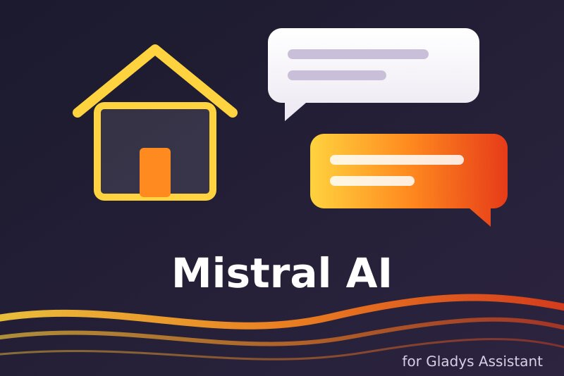
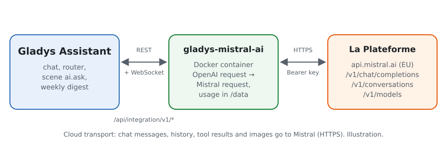
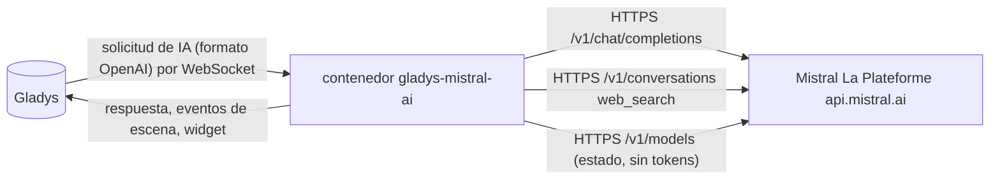
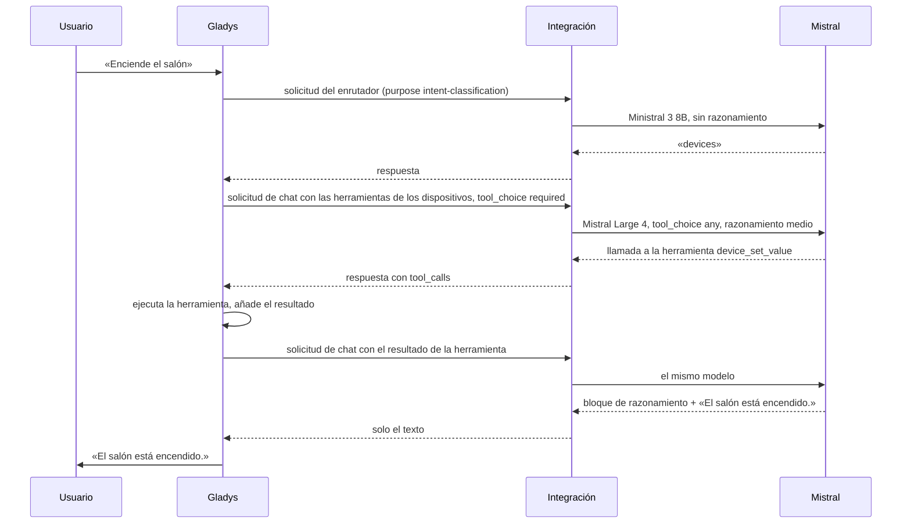
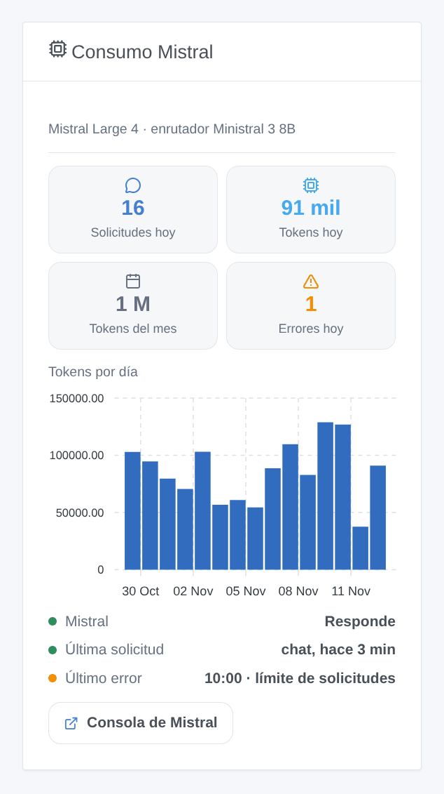

# Gladys Mistral AI

[English](README.md) · [Français](README.fr.md) · [Deutsch](README.de.md) · **Español**

[](LICENSE)
[](https://github.com/William-De71/gladys-mistral-ai/releases)
[](https://github.com/William-De71/gladys-mistral-ai/actions/workflows/release.yml)
[](https://gladysassistant.com)



Integración externa para [Gladys Assistant](https://gladysassistant.com) que hace funcionar el asistente de Gladys con **Mistral AI**, la IA francesa, a través de su API oficial (La Plateforme, alojada en Europa) y su propia clave de API. Una vez elegida en Ajustes → Inteligencia artificial, Mistral responde al chat, controla sus dispositivos, crea escenas, responde a la acción de escena «preguntar a la IA» y redacta el resumen semanal — con o sin cuenta de Gladys Plus.

Documentación de usuario: [English](docs/en.md) · [Français](docs/fr.md) · [Deutsch](docs/de.md) · [Español](docs/es.md).

Sin relación con Mistral AI. **Todavía no probada con una clave real de Mistral**: las solicitudes siguen la documentación oficial y el cliente oficial de Python de Mistral, y las pruebas se ejecutan contra una API simulada. Se agradecen los comentarios.

## Funciones

- **Proveedor de IA** (`type: "ai"`, Gladys 5.3+): cada solicitud de IA de Gladys va a Mistral — el chat con sus llamadas a herramientas, el enrutador de intenciones, la acción de escena «preguntar a la IA», el resumen semanal.
- **Dos modelos**: un modelo de chat (Mistral Large 4 por defecto) y un modelo rápido para el enrutador (Ministral 3 8B por defecto), o cualquier otro identificador de modelo de La Plateforme.
- **Nivel de razonamiento** del modelo del chat (desactivado, bajo, medio, alto), adaptado a lo que acepta cada modelo.
- **Acción de escena «preguntar con búsqueda web»**: Mistral busca en la web y responde brevemente (noticias, tráfico, un evento); la respuesta y las fuentes son salidas para las acciones siguientes.
- **Disparadores de escena**: el asistente falla (clave rechazada, límite de solicitudes, modelo no disponible, API inaccesible) y vuelve a responder — una vez por fallo.
- **Widget del panel**: solicitudes y tokens del día y del mes, tokens por día durante 30 días, última respuesta y último error.
- Botón **Probar la conexión**; la pantalla de configuración indica si Mistral acepta la clave y los modelos.
- Inglés, francés, alemán y español.

## Funcionamiento





Todo el bucle del agente (instrucciones, herramientas, historial, redimensionado de imágenes) se queda en Gladys; la integración traduce cada solicitud y su respuesta:



Lo que gestiona la traducción: identificadores de llamada a herramienta de nueve letras o cifras (los que envía Gladys, como `unknown`, se sustituyen por otros estables), `tool_choice: "required"` escrito `"any"`, los bloques de razonamiento de los modelos que razonan quitados del texto, los argumentos de herramienta siempre como cadena JSON, solo los campos que Mistral conoce. Un error 429 o 5xx se reintenta mientras el tiempo de espera del núcleo lo permita (18 s para el enrutador, 110 s para el chat).

### Transporte

`transports: ["cloud"]`: todo va a `api.mistral.ai` por HTTPS. **Mistral ve cada mensaje del chat, el historial, la definición y el resultado de las herramientas (el estado de los dispositivos que consulta) y las imágenes del chat**, y sus respuestas controlan sus dispositivos y escenas. Gladys nunca recurre a Gladys Plus cuando Mistral falla: el chat dice qué ocurre. `/data` solo guarda los contadores del widget.

## Modelos

| Modelo          | Identificador de API   | Uso                                                                      | Razonamiento                            |
| --------------- | ---------------------- | ------------------------------------------------------------------------ | --------------------------------------- |
| Mistral Large 4 | `mistral-large-4`      | Chat (por defecto): el más capaz, el mejor para crear escenas            | bajo, medio, alto                       |
| Mistral Small 4 | `mistral-small-latest` | Chat: más rápido y barato                                                | desactivado o alto                      |
| Ministral 3 14B | `ministral-14b-latest` | Enrutador o chat ligero                                                  | ninguno                                 |
| Ministral 3 8B  | `ministral-8b-latest`  | Enrutador (por defecto): rápido, dentro de los 20 s que Gladys le deja   | ninguno                                 |
| Ministral 3 3B  | `ministral-3b-latest`  | Enrutador con poco presupuesto                                           | ninguno                                 |
| Otro modelo     | su identificador       | Un modelo más reciente, un ajuste fino: debe poder llamar a herramientas | según el ajuste, se quita si se rechaza |

Identificadores comprobados en la documentación de Mistral el 31 de octubre de 2026. El estado de la configuración avisa cuando un modelo no puede llamar a herramientas.

## Escenas y widget



- **Acción «Mistral: preguntar con búsqueda web»**: campos `question` (se admiten variables de escena), `instructions` (opcional), `premium` (agencias de noticias, `web_search_premium`); salidas `answer` y `sources` (una por línea). Usa el modelo del chat, a través de la API Conversations con `store: false`.
- **Disparador «Mistral: el asistente falla»**: variables `kind` (`auth`, `rate_limit`, `model`, `unreachable`, `timeout`, `server`), `message`, `use`, `model`; filtro por tipo. Una solicitud rechazada (HTTP 400, un modelo que no lee imágenes) solo afecta a esa solicitud y no dispara nada.
- **Disparador «Mistral: el asistente vuelve a responder»**: variable `down_minutes`.
- **Widget «Consumo Mistral»**: contado por la integración a partir del `usage` de cada respuesta; las solicitudes hechas fuera de Gladys con la misma clave no aparecen. La consola de Mistral sigue siendo la referencia para la factura.

Ejemplos:

- _Cada mañana a las 7:30_ → **preguntar con búsqueda web** «las tres principales noticias del día en España, en tres frases cortas» → enviar `{{answer}}` por Telegram.
- _Cuando el asistente falla_ (tipo `auth` o `rate_limit`) → enviar un SMS al administrador con `{{triggerEvent.data.message}}`.
- _Antes de salir_ → **preguntar con búsqueda web** «tráfico en la A-7 entre Málaga y Marbella ahora» → anunciar la respuesta en el altavoz de la entrada.

## Requisitos

- Gladys Assistant **5.3.0** o posterior (proveedores de IA); las instancias más antiguas no pueden instalar la integración.
- Una cuenta de Mistral y una clave de API creada en [console.mistral.ai](https://console.mistral.ai/api-keys).

### Planes y límites de Mistral

- **Experiment** (gratuito, se pide un número de teléfono): una solicitud por segundo aproximadamente y un presupuesto mensual de tokens; Mistral puede usar las solicitudes para mejorar sus modelos — compruebe los ajustes de privacidad de su organización en la consola.
- **Scale** (pago por uso): límites más altos, sin entrenamiento con sus datos. Los precios por modelo están en la página de tarifas de Mistral.
- Un turno de chat de Gladys hace al menos dos solicitudes (enrutador y luego chat), más cuando se llaman herramientas: con el plan gratuito, un 429 se reintenta dentro del tiempo que concede Gladys.

## Instalación

- **Desde la tienda**: Integraciones → Mistral AI → Instalar.
- **Desde la URL del repositorio**: Integraciones → integración externa → `https://github.com/William-De71/gladys-mistral-ai`.
- **Modo desarrollador**: ejecute `npm start` con las variables que da Gladys (ver Desarrollo).

## Configuración

| Campo o botón                    | Por defecto     | Significado                                                                    |
| -------------------------------- | --------------- | ------------------------------------------------------------------------------ |
| Clave de API de Mistral          | —               | Obligatoria, un secreto: nunca se vuelve a mostrar ni se registra              |
| Modelo del chat                  | Mistral Large 4 | Chat, creación de escenas, resumen semanal, acción de búsqueda web             |
| Modelo del enrutador             | Ministral 3 8B  | Clasifica cada mensaje antes de la respuesta, en menos de 20 s                 |
| Identificador del otro modelo    | —               | Se usa cuando un modelo está en «Otro modelo»                                  |
| Razonamiento                     | medio           | El del modelo del chat; el enrutador nunca razona                              |
| Longitud máxima de una respuesta | 8000 tokens     | Razonamiento incluido; auméntela si los registros indican max_tokens alcanzado |
| Probar la conexión               | —               | Una respuesta corta de cada modelo, con su tiempo (consume algunos tokens)     |

## Uso

1. En Gladys (Integraciones → Mistral AI → Configuración): pegue la clave de API, elija los modelos; pulse **Probar la conexión**.
2. Ajustes → **Inteligencia artificial**: elija **Mistral AI** como proveedor.
3. Hable con Gladys en el chat; añada el widget a un panel; use los disparadores y la acción de búsqueda web en sus escenas.

## Desarrollo

```bash
npm install
npm test                       # node --test, una API de Mistral simulada en 127.0.0.1, nunca la red
npm run lint                   # ESLint
npm run format:check           # Prettier
npx github:GladysAssistant/integration-store . --skip-image-check
scripts/build-cover.sh         # cover.jpg desde docs/assets/cover.svg
docs/illustrations/render.sh   # docs/assets/widgets.<idioma>.png
```

En local, el SDK lee `GLADYS_HOST_API_URL`, `GLADYS_INTEGRATION_TOKEN` y `GLADYS_INTEGRATION_SELECTOR` (que da Gladys en modo desarrollador), y la integración lee `TZ`. `DEBUG=gladys-integration-sdk` muestra los registros del SDK.

Las pruebas cubren el cliente HTTP (errores, reintentos, plazos), la conversión en ambos sentidos (`validateAiCompletion` del SDK), el gestor del chat (modelo según el uso, razonamiento, parámetro rechazado), la búsqueda web, los disparadores, los contadores, el widget (`validateWidgetContent`), el manifiesto, los cuatro idiomas, el script de publicación y toda la integración frente al Gladys simulado del SDK. `test/structure.test.js` congela cada clave que guardan los usuarios.

## Proceso de publicación


Cada fusión en `main` lanza la CI y luego calcula la versión a partir de los [Conventional Commits](https://www.conventionalcommits.org/) desde la última etiqueta: `feat` → menor, `fix` / `perf` → parche, `!` o `BREAKING CHANGE` → mayor (una menor por debajo de 1.0.0); `docs`, `chore`, `ci`, `test`, `style`, `refactor`, `build` solos no publican nada. Se genera la sección del changelog, se envía la etiqueta, se construye la imagen multiarquitectura, luego `main` recibe el commit de publicación, se crea la GitHub Release y un último job comprueba la imagen pública, el validador de la tienda y el topic.

- El título de la pull request se convierte en el commit de squash y luego en la línea del changelog: escríbalo en inglés, para el usuario (`pr-title.yml` lo comprueba). No edite nunca `CHANGELOG.md` a mano.
- La 1.0.0 es una decisión: Actions → Release → Run workflow con `release-as: 1.0.0`. `dry-run` muestra la versión y las notas sin publicar.
- **Rama protegida**: la publicación envía su commit a `main` con `GITHUB_TOKEN`. El ruleset `protect-main` (sin borrado, sin force-push) lo deja pasar; una regla más estricta (pull request obligatoria, status checks) necesitaría GitHub Actions en la lista de excepciones, o una GitHub App.
- Tras la primera publicación, haga público el paquete de `ghcr.io` (Package settings → Change visibility); si no, Gladys no puede descargarlo.

## Solución de problemas

Vea [docs/es.md](docs/es.md#solución-de-problemas). Informe de los problemas con las versiones de Gladys y de la integración, los modelos elegidos, su plan de Mistral y el mensaje de **Probar la conexión**. No pegue nunca su clave de API.

## Contribuir

Las issues y pull requests son bienvenidas, sobre todo de personas con una clave de Mistral: una solicitud que falla (sin la clave) ayuda mucho. Ejecute `npm run format:check && npm run lint && npm test` antes de abrir una pull request y mantenga sin cambios cada clave guardada (ver [CLAUDE.md](CLAUDE.md)).

## Seguridad

Vea [SECURITY.md](SECURITY.md): informe de las vulnerabilidades en privado. La clave de API es un campo `secret`: nunca se registra, nunca se escribe en `/data` y solo se envía a `api.mistral.ai` por HTTPS.

## Capturas pendientes

Las imágenes de arriba son ilustraciones, no capturas de pantalla. Las capturas reales irán en `docs/assets/screenshots/` (PNG, 1280 × 800): `configuration.png` (la configuración con su estado), `ai-settings.png` (Mistral elegido en Ajustes → Inteligencia artificial), `chat.png` (un chat que enciende un dispositivo), `scene-web-search.png` (la acción de búsqueda web en una escena).

## Licencia

[Apache License 2.0](LICENSE) — vea también [NOTICE](NOTICE). Mistral AI, Mistral y Ministral son marcas de Mistral AI; este proyecto no está afiliado a Mistral AI ni cuenta con su respaldo o patrocinio. Gracias a la documentación y al SDK de Gladys, y a la documentación de Mistral y sus clientes oficiales.
