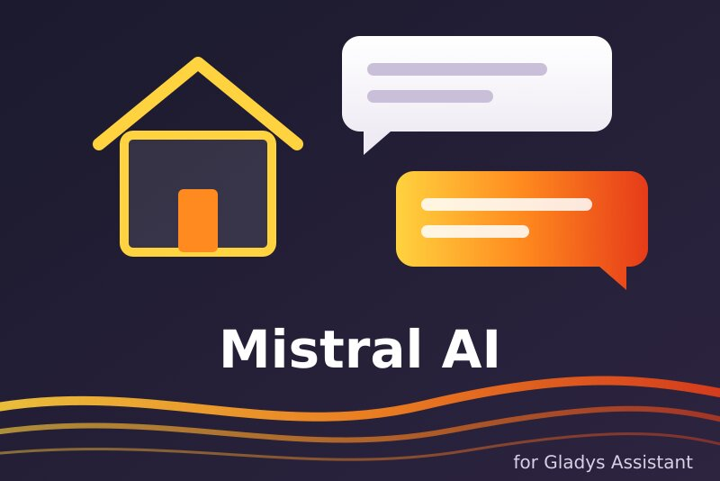
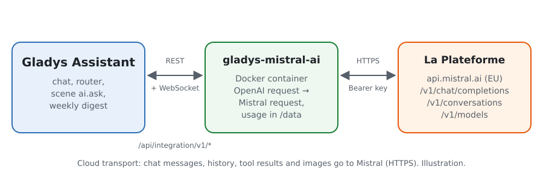
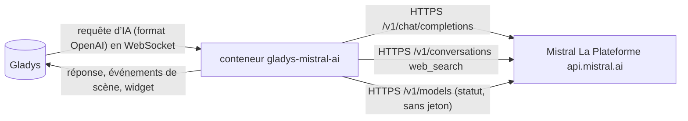
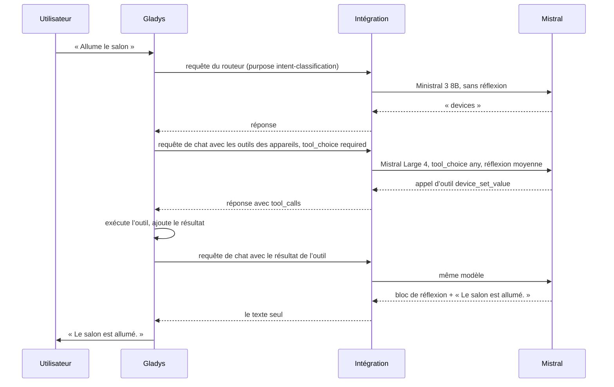
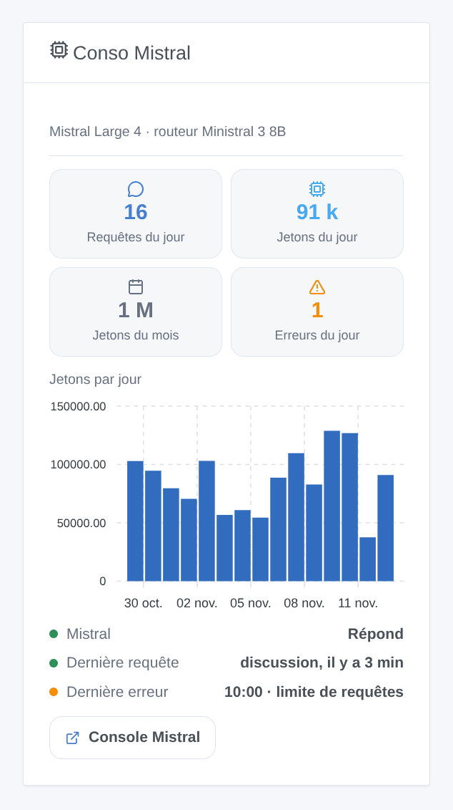

# Gladys Mistral AI

[English](README.md) · **Français** · [Deutsch](README.de.md) · [Español](README.es.md)

[](LICENSE)
[](https://github.com/William-De71/gladys-mistral-ai/releases)
[](https://github.com/William-De71/gladys-mistral-ai/actions/workflows/release.yml)
[](https://gladysassistant.com)



Intégration externe pour [Gladys Assistant](https://gladysassistant.com) qui fait tourner l’assistant de Gladys sur **Mistral AI**, l’IA française, via son API officielle (La Plateforme, hébergée en Europe) et votre propre clé d’API. Une fois choisie dans Paramètres → Intelligence artificielle, Mistral répond au chat, pilote vos appareils, crée des scènes, répond à l’action de scène « demander à l’IA » et rédige le résumé hebdomadaire — avec ou sans compte Gladys Plus.

Documentation utilisateur : [English](docs/en.md) · [Français](docs/fr.md) · [Deutsch](docs/de.md) · [Español](docs/es.md).

Sans lien avec Mistral AI. **Pas encore testée avec une vraie clé Mistral** : les requêtes suivent la documentation officielle et le client Python officiel de Mistral, et les tests tournent contre une fausse API. Les retours sont bienvenus.

## Fonctionnalités

- **Fournisseur d’IA** (`type: "ai"`, Gladys 5.3+) : chaque requête d’IA de Gladys part chez Mistral — le chat et ses appels d’outils, le routeur d’intentions, l’action de scène « demander à l’IA », le résumé hebdomadaire.
- **Deux modèles** : un modèle de chat (Mistral Large 4 par défaut) et un modèle rapide pour le routeur (Ministral 3 8B par défaut), ou tout autre identifiant de modèle de La Plateforme.
- **Niveau de réflexion** du modèle du chat (désactivée, faible, moyenne, élevée), adapté à ce que chaque modèle accepte.
- **Action de scène « demander avec recherche web »** : Mistral cherche sur le web et répond brièvement (actualités, trafic, un événement) ; la réponse et les sources sont des sorties pour les actions suivantes.
- **Déclencheurs de scène** : l’assistant est en erreur (clé refusée, limite de requêtes, modèle indisponible, API injoignable) et répond de nouveau — une fois par panne.
- **Widget de tableau de bord** : requêtes et jetons du jour et du mois, jetons par jour sur 30 jours, dernière réponse et dernière erreur.
- Bouton **Tester la connexion** ; l’écran de configuration indique si Mistral accepte la clé et les modèles.
- Anglais, français, allemand et espagnol.

## Fonctionnement





Toute la boucle d’agent (consignes, outils, historique, redimensionnement des images) reste dans Gladys ; l’intégration traduit chaque requête et sa réponse :



Ce que la traduction gère : des identifiants d’appel d’outil de neuf lettres ou chiffres (ceux que Gladys envoie, comme `unknown`, sont remplacés par des identifiants stables), `tool_choice: "required"` écrit `"any"`, les blocs de réflexion des modèles qui raisonnent retirés du texte, les arguments d’outil toujours en chaîne JSON, seulement les champs que Mistral connaît. Une erreur 429 ou 5xx est retentée tant que le délai d’attente du cœur le permet (18 s pour le routeur, 110 s pour le chat).

### Transport

`transports: ["cloud"]` : tout part vers `api.mistral.ai` en HTTPS. **Mistral voit chaque message du chat, l’historique, la définition et le résultat des outils (l’état des appareils qu’il consulte) et les images du chat**, et ses réponses pilotent vos appareils et vos scènes. Gladys ne se replie jamais sur Gladys Plus quand Mistral échoue : le chat dit ce qui ne va pas. `/data` ne garde que les compteurs du widget.

## Modèles

| Modèle          | Identifiant d’API      | Usage                                                                  | Réflexion                            |
| --------------- | ---------------------- | ---------------------------------------------------------------------- | ------------------------------------ |
| Mistral Large 4 | `mistral-large-4`      | Chat (par défaut) : le plus capable, le meilleur pour créer des scènes | faible, moyenne, élevée              |
| Mistral Small 4 | `mistral-small-latest` | Chat : plus rapide et moins cher                                       | désactivée ou élevée                 |
| Ministral 3 14B | `ministral-14b-latest` | Routeur ou chat léger                                                  | aucune                               |
| Ministral 3 8B  | `ministral-8b-latest`  | Routeur (par défaut) : rapide, sous les 20 s que Gladys lui laisse     | aucune                               |
| Ministral 3 3B  | `ministral-3b-latest`  | Routeur à petit budget                                                 | aucune                               |
| Autre modèle    | votre identifiant      | Un modèle plus récent, un modèle affiné : il doit appeler des outils   | selon le réglage, retirée si refusée |

Identifiants vérifiés dans la documentation de Mistral le 31 octobre 2026. Le statut de la configuration prévient quand un modèle ne sait pas appeler d’outils.

## Scènes et widget



- **Action « Mistral : demander avec recherche web »** : champs `question` (variables de scène acceptées), `instructions` (facultatif), `premium` (agences de presse, `web_search_premium`) ; sorties `answer` et `sources` (une par ligne). Utilise le modèle du chat, via l’API Conversations avec `store: false`.
- **Déclencheur « Mistral : l’assistant est en erreur »** : variables `kind` (`auth`, `rate_limit`, `model`, `unreachable`, `timeout`, `server`), `message`, `use`, `model` ; filtre par type. Une requête refusée (HTTP 400, un modèle qui ne lit pas les images) ne concerne que cette requête et ne déclenche rien.
- **Déclencheur « Mistral : l’assistant répond de nouveau »** : variable `down_minutes`.
- **Widget « Conso Mistral »** : compté par l’intégration à partir du `usage` de chaque réponse ; les requêtes faites hors de Gladys avec la même clé n’y sont pas. La console Mistral reste la référence pour la facture.

Exemples :

- _Chaque matin à 7 h 30_ → **demander avec recherche web** « les trois principales actualités du jour en France, en trois phrases courtes » → envoyer `{{answer}}` par Telegram.
- _Quand l’assistant est en erreur_ (type `auth` ou `rate_limit`) → envoyer un SMS à l’administrateur avec `{{triggerEvent.data.message}}`.
- _Avant de partir_ → **demander avec recherche web** « trafic sur l’A7 entre Lyon et Valence maintenant » → annoncer la réponse sur l’enceinte de l’entrée.

## Prérequis

- Gladys Assistant **5.3.0** ou plus récent (fournisseurs d’IA) ; les instances plus anciennes ne peuvent pas installer l’intégration.
- Un compte Mistral et une clé d’API créée sur [console.mistral.ai](https://console.mistral.ai/api-keys).

### Offres et limites de Mistral

- **Experiment** (gratuite, numéro de téléphone demandé) : environ une requête par seconde et un budget mensuel de jetons ; Mistral peut utiliser les requêtes pour améliorer ses modèles — vérifiez les réglages de confidentialité de votre organisation dans la console.
- **Scale** (paiement à l’usage) : limites plus hautes, pas d’entraînement sur vos données. Les prix par modèle sont sur la page des tarifs de Mistral.
- Un tour de chat de Gladys fait au moins deux requêtes (routeur, puis chat), plus quand des outils sont appelés : avec l’offre gratuite, une 429 est retentée dans le délai que Gladys accorde.

## Installation

- **Depuis le store** : Intégrations → Mistral AI → Installer.
- **Depuis l’URL du dépôt** : Intégrations → intégration externe → `https://github.com/William-De71/gladys-mistral-ai`.
- **Mode développeur** : lancez `npm start` avec les variables fournies par Gladys (voir Développement).

## Configuration

| Champ ou bouton                 | Par défaut      | Rôle                                                                           |
| ------------------------------- | --------------- | ------------------------------------------------------------------------------ |
| Clé d’API Mistral               | —               | Obligatoire, un secret : plus jamais affichée, jamais journalisée              |
| Modèle du chat                  | Mistral Large 4 | Chat, création de scènes, résumé hebdomadaire, action de recherche web         |
| Modèle du routeur               | Ministral 3 8B  | Trie chaque message avant la réponse, en moins de 20 s                         |
| Identifiant de l’autre modèle   | —               | Utilisé quand un modèle est réglé sur « Autre modèle »                         |
| Réflexion                       | moyenne         | Celle du modèle du chat ; le routeur ne réfléchit jamais                       |
| Longueur maximale d’une réponse | 8000 jetons     | Réflexion comprise ; augmentez-la si les journaux indiquent max_tokens atteint |
| Tester la connexion             | —               | Une réponse courte de chaque modèle, avec son temps (consomme quelques jetons) |

## Utilisation

1. Dans Gladys (Intégrations → Mistral AI → Configuration) : collez la clé d’API, choisissez les modèles ; appuyez sur **Tester la connexion**.
2. Paramètres → **Intelligence artificielle** : choisissez **Mistral AI** comme fournisseur.
3. Parlez à Gladys dans le chat ; ajoutez le widget à un tableau de bord ; utilisez les déclencheurs et l’action de recherche web dans vos scènes.

## Développement

```bash
npm install
npm test                       # node --test, une fausse API Mistral sur 127.0.0.1, jamais le réseau
npm run lint                   # ESLint
npm run format:check           # Prettier
npx github:GladysAssistant/integration-store . --skip-image-check
scripts/build-cover.sh         # cover.jpg depuis docs/assets/cover.svg
docs/illustrations/render.sh   # docs/assets/widgets.<langue>.png
```

En local, le SDK lit `GLADYS_HOST_API_URL`, `GLADYS_INTEGRATION_TOKEN` et `GLADYS_INTEGRATION_SELECTOR` (fournies par Gladys en mode développeur), et l’intégration lit `TZ`. `DEBUG=gladys-integration-sdk` affiche les journaux du SDK.

Les tests couvrent le client HTTP (erreurs, nouvelles tentatives, délais), la conversion dans les deux sens (`validateAiCompletion` du SDK), le gestionnaire du chat (modèle selon l’usage, réflexion, paramètre refusé), la recherche web, les déclencheurs, les compteurs, le widget (`validateWidgetContent`), le manifeste, les quatre langues, le script de release, et toute l’intégration face au faux Gladys du SDK. `test/structure.test.js` fige chaque clé que les utilisateurs enregistrent.

## Processus de release


Chaque fusion sur `main` lance la CI, puis calcule la version depuis les [Conventional Commits](https://www.conventionalcommits.org/) du dernier tag : `feat` → mineure, `fix` / `perf` → correctif, `!` ou `BREAKING CHANGE` → majeure (une mineure sous 1.0.0) ; `docs`, `chore`, `ci`, `test`, `style`, `refactor`, `build` seuls ne publient rien. La section du changelog est générée, le tag poussé, l’image multi-architecture construite, puis `main` reçoit le commit de release, la GitHub Release est créée et un dernier job vérifie l’image publique, le validateur du store et le topic.

- Le titre de la pull request devient le commit de squash, puis la ligne du changelog : écrivez-le en anglais, pour l’utilisateur (`pr-title.yml` le vérifie). Ne modifiez jamais `CHANGELOG.md` à la main.
- La 1.0.0 est une décision : Actions → Release → Run workflow avec `release-as: 1.0.0`. `dry-run` affiche la version et les notes sans rien publier.
- **Branche protégée** : la release pousse son commit sur `main` avec `GITHUB_TOKEN`. Le ruleset `protect-main` (ni suppression, ni force-push) le laisse passer ; une règle plus stricte (pull request obligatoire, status checks) demanderait GitHub Actions dans la liste de contournement, ou une GitHub App.
- Après la première release, rendez public le package `ghcr.io` (Package settings → Change visibility), sinon Gladys ne peut pas le télécharger.

## Dépannage

Voir [docs/fr.md](docs/fr.md#dépannage). Signalez un problème avec les versions de Gladys et de l’intégration, les modèles choisis, votre offre Mistral et le message de **Tester la connexion**. Ne collez jamais votre clé d’API.

## Contribuer

Issues et pull requests bienvenues, surtout de la part de personnes qui ont une clé Mistral : une requête qui échoue (sans la clé) aide beaucoup. Lancez `npm run format:check && npm run lint && npm test` avant d’ouvrir une pull request, et gardez chaque clé enregistrée inchangée (voir [CLAUDE.md](CLAUDE.md)).

## Sécurité

Voir [SECURITY.md](SECURITY.md) : signalez les vulnérabilités en privé. La clé d’API est un champ `secret` : jamais journalisée, jamais écrite dans `/data`, envoyée uniquement à `api.mistral.ai` en HTTPS.

## Captures à venir

Les images ci-dessus sont des illustrations, pas des captures d’écran. Les vraies captures iront dans `docs/assets/screenshots/` (PNG, 1280 × 800) : `configuration.png` (la configuration et son statut), `ai-settings.png` (Mistral choisi dans Paramètres → Intelligence artificielle), `chat.png` (un chat qui allume un appareil), `scene-web-search.png` (l’action de recherche web dans une scène).

## Licence

[Apache License 2.0](LICENSE) — voir aussi [NOTICE](NOTICE). Mistral AI, Mistral et Ministral sont des marques de Mistral AI ; ce projet n’est ni affilié à Mistral AI, ni approuvé, ni soutenu par Mistral AI. Merci à la documentation et au SDK de Gladys, et à la documentation de Mistral et à ses clients officiels.
