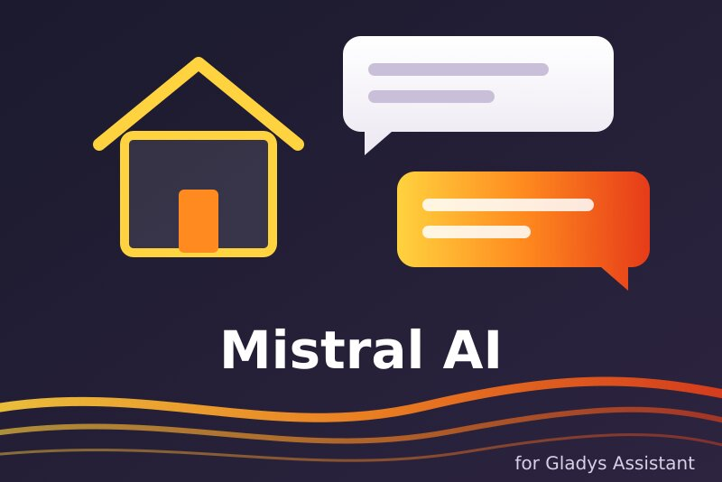
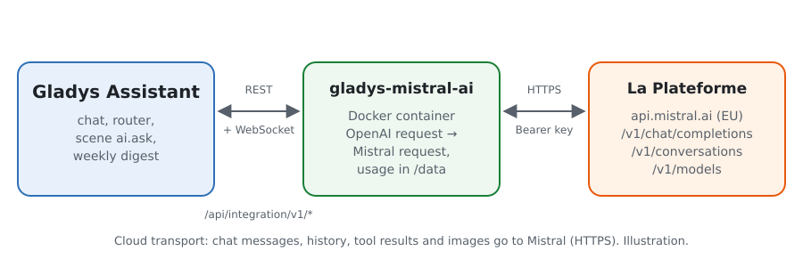
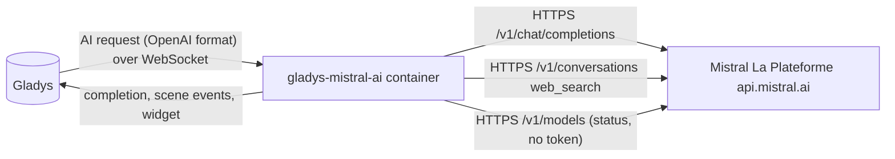
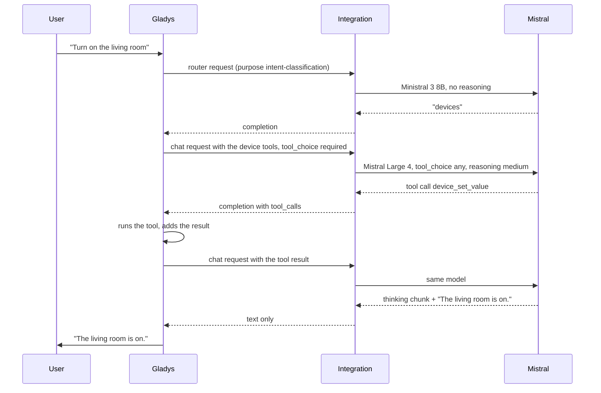
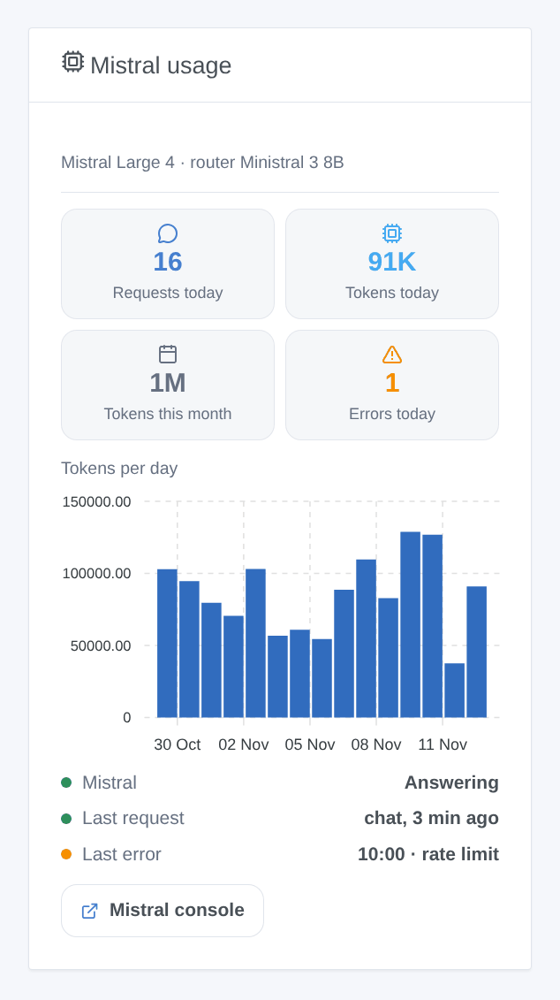

# Gladys Mistral AI

**English** · [Français](README.fr.md) · [Deutsch](README.de.md) · [Español](README.es.md)

[](LICENSE)
[](https://github.com/William-De71/gladys-mistral-ai/releases)
[](https://github.com/William-De71/gladys-mistral-ai/actions/workflows/release.yml)
[](https://gladysassistant.com)



[Gladys Assistant](https://gladysassistant.com) external integration that runs the assistant of Gladys on **Mistral AI**, the French AI, through its official API (La Plateforme, hosted in Europe) and your own API key. Once selected in Settings → Artificial Intelligence, Mistral answers the chat, controls your devices, creates scenes, answers the "ask the AI" scene action and writes the weekly digest — with or without a Gladys Plus account.

User documentation: [English](docs/en.md) · [Français](docs/fr.md) · [Deutsch](docs/de.md) · [Español](docs/es.md).

Not affiliated with Mistral AI. **Not tested with a real Mistral key yet**: the requests follow the official documentation and Python client of Mistral, and the tests run against a fake API. Feedback welcome.

## Features

- **AI provider** (`type: "ai"`, Gladys 5.3+): every AI request of Gladys goes to Mistral — the chat with its tool calls, the intent router, the scene "ask the AI" action, the weekly digest.
- **Two models**: a chat model (Mistral Large 4 by default) and a fast router model (Ministral 3 8B by default), or any other model id of La Plateforme.
- **Reasoning level** of the chat model (off, low, medium, high), adapted to what each model accepts.
- **Scene action "ask with web search"**: Mistral searches the web and answers briefly (news, traffic, an event); the answer and the sources are outputs for the next actions.
- **Scene triggers**: the assistant fails (key refused, rate limit, model unavailable, API unreachable) and answers again — once per failure.
- **Dashboard widget**: requests and tokens of the day and of the month, tokens per day over 30 days, last answer and last error.
- **Test the connection** button; the configuration screen shows whether Mistral accepts the key and the models.
- English, French, German and Spanish.

## How it works





The whole agentic loop (prompts, tools, history, image resizing) stays in Gladys; the integration translates each request and its answer:



What the translation handles: tool call ids of nine letters or digits (the ids Gladys sends, such as `unknown`, are mapped to stable ones), `tool_choice: "required"` spelled `"any"`, the thinking chunks of reasoning models removed from the text, tool arguments always as a JSON string, only the fields Mistral knows. A 429 or a 5xx is retried while the time the core waits allows it (18 s for the router, 110 s for the chat).

### Transport

`transports: ["cloud"]`: everything goes to `api.mistral.ai` over HTTPS. **Mistral sees every chat message, the history, the tool definitions and results (the state of the devices it reads) and the chat images**, and its answers drive your devices and scenes. Gladys never falls back to Gladys Plus when Mistral fails: the chat says what is wrong. `/data` only keeps the usage counters of the widget.

## Models

| Model           | API id                 | Use                                                           | Reasoning                    |
| --------------- | ---------------------- | ------------------------------------------------------------- | ---------------------------- |
| Mistral Large 4 | `mistral-large-4`      | Chat (default): the most capable, best for creating scenes    | low, medium, high            |
| Mistral Small 4 | `mistral-small-latest` | Chat: faster and cheaper                                      | off or high                  |
| Ministral 3 14B | `ministral-14b-latest` | Router or light chat                                          | none                         |
| Ministral 3 8B  | `ministral-8b-latest`  | Router (default): fast, under the 20 s Gladys gives it        | none                         |
| Ministral 3 3B  | `ministral-3b-latest`  | Router on a tight budget                                      | none                         |
| Other model     | your id                | A newer model, a fine-tune: it must call tools (see the logs) | as asked, dropped if refused |

Ids checked in the Mistral documentation on 31 October 2026. The configuration status warns when a model cannot call tools.

## Scenes and widget



- **Action "Mistral: ask with web search"**: fields `question` (scene variables allowed), `instructions` (optional), `premium` (news agencies, `web_search_premium`); outputs `answer` and `sources` (one per line). Uses the chat model, through the Conversations API with `store: false`.
- **Trigger "Mistral: the assistant fails"**: variables `kind` (`auth`, `rate_limit`, `model`, `unreachable`, `timeout`, `server`), `message`, `use`, `model`; filter by kind. A refused request (HTTP 400, a model that cannot read an image) is about that request only and starts nothing.
- **Trigger "Mistral: the assistant answers again"**: variable `down_minutes`.
- **Widget "Mistral usage"**: counted by the integration from the `usage` of each answer; requests made outside Gladys with the same key are not in it. The Mistral console stays the reference for the bill.

Examples:

- _Every morning at 7:30_ → **ask with web search** "the three main news of the day in France, in three short sentences" → send `{{answer}}` by Telegram.
- _When the assistant fails_ (kind `auth` or `rate_limit`) → send an SMS to the administrator with `{{triggerEvent.data.message}}`.
- _Before leaving_ → **ask with web search** "traffic on the A7 between Lyon and Valence now" → speak the answer on the speaker of the hall.

## Requirements

- Gladys Assistant **5.3.0** or later (AI providers); older instances cannot install the integration.
- A Mistral account and an API key from [console.mistral.ai](https://console.mistral.ai/api-keys).

### Mistral plans and limits

- **Experiment** (free, phone number required): about one request per second and a monthly token budget; Mistral may use the requests to improve its models — check the privacy settings of your organization in the console.
- **Scale** (pay as you go): higher limits, no training on your data. Prices per model are on the Mistral pricing page.
- A chat turn of Gladys makes at least two requests (router, then chat), more when tools are called: on the free plan, a 429 is retried within the time Gladys waits.

## Installation

- **From the store**: Integrations → Mistral AI → Install.
- **From the repository URL**: Integrations → external integration → `https://github.com/William-De71/gladys-mistral-ai`.
- **Developer mode**: run `npm start` with the variables given by Gladys (see Development).

## Configuration

| Field or button       | Default         | Meaning                                                               |
| --------------------- | --------------- | --------------------------------------------------------------------- |
| Mistral API key       | —               | Required, a secret: never shown again, never logged                   |
| Chat model            | Mistral Large 4 | Chat, scene creation, weekly digest, web search action                |
| Router model          | Ministral 3 8B  | Sorts every message before the answer, within 20 s                    |
| Other model id        | —               | Used when a model is set to "Other model"                             |
| Reasoning             | medium          | Of the chat model; the router never reasons                           |
| Maximum answer length | 8000 tokens     | Reasoning included; raise it if the logs say an answer hit max_tokens |
| Test the connection   | —               | One short answer from each model, with its time (spends a few tokens) |

## Usage

1. In Gladys (Integrations → Mistral AI → Configuration): paste the API key, choose the models; press **Test the connection**.
2. Settings → **Artificial Intelligence**: choose **Mistral AI** as the provider.
3. Talk to Gladys in the chat; add the widget to a dashboard; use the triggers and the web search action in your scenes.

## Development

```bash
npm install
npm test                       # node --test, a fake Mistral API on 127.0.0.1, never the network
npm run lint                   # ESLint
npm run format:check           # Prettier
npx github:GladysAssistant/integration-store . --skip-image-check
scripts/build-cover.sh         # cover.jpg from docs/assets/cover.svg
docs/illustrations/render.sh   # docs/assets/widgets.<lang>.png
```

Locally, the SDK reads `GLADYS_HOST_API_URL`, `GLADYS_INTEGRATION_TOKEN` and `GLADYS_INTEGRATION_SELECTOR` (given by Gladys in developer mode), and the integration reads `TZ`. `DEBUG=gladys-integration-sdk` shows the SDK logs.

The tests cover the HTTP client (errors, retries, deadlines), the conversion both ways (`validateAiCompletion` of the SDK), the chat handler (models per purpose, reasoning, refused parameter), the web search, the triggers, the usage counters, the widget (`validateWidgetContent`), the manifest, the four languages, the release script, and the whole integration against the fake Gladys of the SDK. `test/structure.test.js` freezes every key users store.

## Release process


Every merge on `main` runs the CI, then computes the version from the [Conventional Commits](https://www.conventionalcommits.org/) since the last tag: `feat` → minor, `fix` / `perf` → patch, `!` or `BREAKING CHANGE` → major (a minor below 1.0.0); `docs`, `chore`, `ci`, `test`, `style`, `refactor`, `build` alone publish nothing. The changelog section is generated, the tag pushed, the multi-architecture image built, then `main` receives the release commit, the GitHub Release is created and a last job checks the public image, the store validator and the topic.

- The pull request title becomes the squash commit, then the changelog line: write it in English, for the user (`pr-title.yml` checks it). Never edit `CHANGELOG.md` by hand.
- 1.0.0 is a decision: Actions → Release → Run workflow with `release-as: 1.0.0`. `dry-run` shows the version and the notes without publishing.
- **Protected branch**: the release pushes its commit to `main` with `GITHUB_TOKEN`. The `protect-main` ruleset (no deletion, no force-push) lets it through; a stricter rule (pull request required, status checks) would need GitHub Actions in its bypass list, or a GitHub App.
- After the first release, make the `ghcr.io` package public (Package settings → Change visibility), or Gladys cannot pull it.

## Troubleshooting

See [docs/en.md](docs/en.md#troubleshooting). Report issues with the versions of Gladys and of the integration, the models chosen, your Mistral plan and the message of **Test the connection**. Never paste your API key.

## Contributing

Issues and pull requests are welcome, especially from people with a Mistral key: a failing request (without the key) helps a lot. Run `npm run format:check && npm run lint && npm test` before opening a pull request, and keep every stored key unchanged (see [CLAUDE.md](CLAUDE.md)).

## Security

See [SECURITY.md](SECURITY.md): report vulnerabilities privately. The API key is a `secret` field: never logged, never written to `/data`, sent only to `api.mistral.ai` over HTTPS.

## Screenshots to come

The images above are illustrations, not screenshots. Real screenshots will go in `docs/assets/screenshots/` (PNG, 1280 × 800): `configuration.png` (the configuration with its status), `ai-settings.png` (Mistral chosen in Settings → Artificial Intelligence), `chat.png` (a chat that switches a device on), `scene-web-search.png` (the web search action in a scene).

## License

[Apache License 2.0](LICENSE) — see also [NOTICE](NOTICE). Mistral AI, Mistral and Ministral are trademarks of Mistral AI; this project is not affiliated with, endorsed or sponsored by Mistral AI. Thanks to the Gladys documentation and SDK, and to the Mistral documentation and its official clients.
