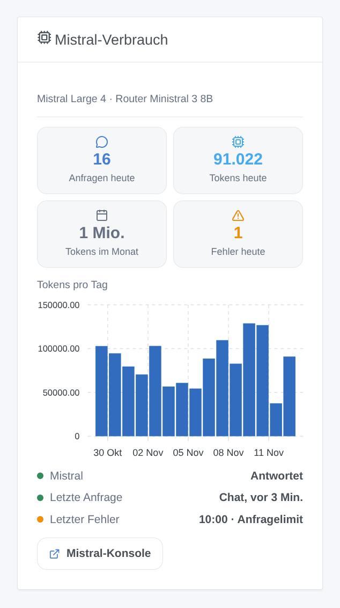

# Mistral AI

## Überblick

Diese Integration betreibt den Assistenten von Gladys mit **Mistral AI**, der KI aus Frankreich, über ihre offizielle API (La Plateforme, in Europa gehostet) und deinen eigenen API-Schlüssel. Sobald du sie unter **Einstellungen → Künstliche Intelligenz** wählst, geht jede KI-Anfrage von Gladys an Mistral: der Chat und die Geräte, die er steuert, die Szenen, die er erstellt, die Szenenaktion „KI fragen“ und der Wochenrückblick. Sie funktioniert mit oder ohne Gladys-Plus-Konto.

Dazu kommen eine Szenenaktion, die Mistral eine Frage **mit Websuche** stellt, zwei Szenenauslöser (der Assistent schlägt fehl, der Assistent antwortet wieder) und ein Dashboard-Widget zu deinem Verbrauch.

Nicht mit Mistral AI verbunden. Noch nicht mit einem echten Mistral-Schlüssel getestet: Rückmeldungen sind willkommen.

## Voraussetzungen

- Gladys Assistant 5.3.0 oder neuer.
- Ein Mistral-Konto und ein API-Schlüssel: [console.mistral.ai](https://console.mistral.ai/api-keys), **API-Schlüssel** → **Neuen Schlüssel erstellen**.
- **Kostenloser Tarif Experiment**: etwa eine Anfrage pro Sekunde und ein monatliches Token-Budget; Mistral darf deine Anfragen zur Verbesserung seiner Modelle nutzen (prüfe die Datenschutzeinstellungen deiner Organisation in der Konsole). **Tarif Scale** (nutzungsabhängig): höhere Grenzen, kein Training mit deinen Daten.
- Was dein Zuhause verlässt: jede Chat-Nachricht, der Verlauf, die Werkzeuge, die Gladys anbietet, und ihre Ergebnisse (der Zustand der Geräte, die Mistral abfragt) sowie die Bilder des Chats gehen per HTTPS an Mistral. Die Antworten von Mistral steuern deine Geräte und erstellen Szenen.

## Konfiguration

| Feld oder Schaltfläche         | Standard        | Bedeutung                                                                                      |
| ------------------------------ | --------------- | ---------------------------------------------------------------------------------------------- |
| Mistral-API-Schlüssel          | —               | Pflicht. Nie wieder angezeigt, nie protokolliert                                               |
| Chat-Modell                    | Mistral Large 4 | Beantwortet den Chat, erstellt Szenen, schreibt den Wochenrückblick, führt die Websuche aus    |
| Router-Modell                  | Ministral 3 8B  | Ordnet jede Nachricht vor der Antwort ein und muss innerhalb von 20 Sekunden antworten         |
| ID des anderen Modells         | —               | Nur wenn ein Modell auf „Anderes Modell“ steht: die genaue API-ID (es muss Werkzeuge aufrufen) |
| Nachdenken des Chat-Modells    | Mittel          | Mehr Nachdenken, bessere Szenen, langsamere Antworten                                          |
| Maximale Antwortlänge (Tokens) | 8000            | Nachdenken inbegriffen                                                                         |
| Verbindung testen              | —               | Eine kurze Antwort jedes Modells mit seiner Zeit; verbraucht ein paar Tokens                   |

Der Status des Konfigurationsbildschirms zeigt, ob Mistral den Schlüssel und beide Modelle akzeptiert, ohne ein Token zu verbrauchen, und warnt, wenn ein Modell keine Werkzeuge aufrufen kann.

## Verwendung

1. Integrationen → **Mistral AI** → Konfiguration: API-Schlüssel einfügen, die Standardmodelle behalten, **Verbindung testen** drücken.
2. Einstellungen → **Künstliche Intelligenz**: **Mistral AI** wählen.
3. Sprich mit Gladys im Chat: „schalte das Wohnzimmer ein“, „wie warm ist es im Schlafzimmer?“, „erstelle eine Szene, die bei Sonnenuntergang die Rollläden schließt“.

### Modelle wählen

- **Mistral Large 4** (Standard für den Chat): am leistungsfähigsten, am besten zum Erstellen von Szenen; es denkt immer nach (niedrig, mittel oder hoch).
- **Mistral Small 4**: schneller und günstiger; Nachdenken aus oder hoch.
- **Ministral 3** (14B, 8B, 3B): klein und schnell, ohne Nachdenken; Ministral 3 8B ist der Standard-Router. Beim Erstellen von Szenen sind sie weniger zuverlässig.
- **Anderes Modell**: ein neueres Mistral-Modell oder eines deiner Fine-Tunes. Lehnt es den Parameter für das Nachdenken ab, sendet die Integration ihn ab dann nicht mehr.

### Dashboard-Widget

Das Widget **Mistral-Verbrauch** zeigt die Anfragen und Tokens des Tages, die Tokens des Monats, die Fehler des Tages, die Tokens pro Tag über 30 Tage, ob Mistral antwortet, die letzte Anfrage und den letzten Fehler. Es zählt, was Gladys angefragt hat; für die Rechnung bleibt die Mistral-Konsole maßgeblich.

### Szenen

- **Aktion „Mistral: mit Websuche fragen“**: Mistral sucht im Web und antwortet in wenigen Sätzen. Felder: die Frage (Szenenvariablen erlaubt), zusätzliche Anweisungen, Nachrichtenagenturen (Premium-Suche). Ausgaben: die Antwort und die Quellen, eine pro Zeile.
- **Auslöser „Mistral: Der Assistent schlägt fehl“**: einmal pro Ausfall (Schlüssel abgelehnt, Anfragelimit, Modell nicht verfügbar, API nicht erreichbar, zu langsam, Mistral-Fehler), mit Art, Meldung, Anfrage und Modell.
- **Auslöser „Mistral: Der Assistent antwortet wieder“**: die erste Antwort nach einem Ausfall, mit den Minuten des Ausfalls.

Beispiele: jeden Morgen mit Websuche nach den Nachrichten des Tages fragen und die Antwort per Telegram senden; wenn der Assistent mit abgelehntem Schlüssel fehlschlägt, dem Administrator eine SMS senden.

## Fehlerbehebung

- **„Mistral hat den API-Schlüssel abgelehnt“**: Kopiere den Schlüssel erneut aus der Konsole; ein gelöschter oder abgelaufener Schlüssel ergibt dieselbe Meldung.
- **„Anfragelimit erreicht“**: Der kostenlose Tarif erlaubt etwa eine Anfrage pro Sekunde. Die Integration wiederholt innerhalb der Wartezeit von Gladys; passiert es oft, wechsle zum Tarif Scale oder wähle ein kleineres Router-Modell.
- **„… ist für diesen API-Schlüssel nicht verfügbar“**: Das Modell existiert nicht oder ist für deinen Tarif nicht freigegeben; wähle ein anderes.
- **Der Chat antwortet, ohne etwas zu tun**: Das gewählte Modell kann vielleicht keine Werkzeuge aufrufen (siehe Status), oder das Nachdenken ist bei einem kleinen Modell aus; versuche Mistral Large 4.
- **„Die Antwort wurde bei max_tokens abgeschnitten“**: Erhöhe die maximale Antwortlänge.
- **Ein Bild im Chat schlägt fehl**: Das gewählte Modell liest vielleicht keine Bilder; die Mistral-Modelle der Liste lesen sie alle.
- Protokolle: Einstellungen → Supervision, die Protokolle der Integration. Teile nie deinen API-Schlüssel.
