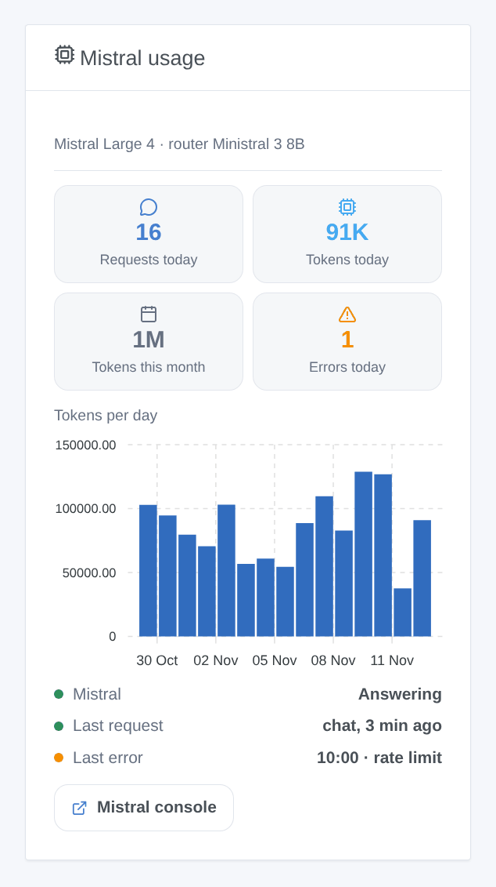

# Mistral AI

## Overview

This integration runs the assistant of Gladys on **Mistral AI**, the French AI, through its official API (La Plateforme, hosted in Europe) and your own API key. Once you choose it in **Settings → Artificial Intelligence**, every AI request of Gladys goes to Mistral: the chat and the devices it controls, the scenes it creates, the "ask the AI" scene action and the weekly digest. It works with or without a Gladys Plus account.

It also adds a scene action that asks Mistral a question **with web search**, two scene triggers (the assistant fails, the assistant answers again) and a dashboard widget of your consumption.

Not affiliated with Mistral AI. Not tested with a real Mistral key yet: feedback welcome.

## Prerequisites

- Gladys Assistant 5.3.0 or later.
- A Mistral account and an API key: [console.mistral.ai](https://console.mistral.ai/api-keys), **API Keys** → **Create new key**.
- **Free Experiment plan**: about one request per second and a monthly token budget; Mistral may use your requests to improve its models (check the privacy settings of your organization in the console). **Scale plan** (pay as you go): higher limits, no training on your data.
- What leaves your home: every chat message, the history, the tools Gladys offers and their results (the state of the devices Mistral reads) and the chat images go to Mistral over HTTPS. Mistral's answers control your devices and create scenes.

## Configuration

| Field or button                | Default         | Meaning                                                                                |
| ------------------------------ | --------------- | -------------------------------------------------------------------------------------- |
| Mistral API key                | —               | Required. Never shown again, never logged                                              |
| Chat model                     | Mistral Large 4 | Answers the chat, creates scenes, writes the weekly digest, runs the web search action |
| Router model                   | Ministral 3 8B  | Sorts every message before the answer and must reply within 20 seconds                 |
| Other model id                 | —               | Only when a model is set to "Other model": the exact API id (it must call tools)       |
| Reasoning of the chat model    | Medium          | More reasoning, better scenes, slower answers                                          |
| Maximum answer length (tokens) | 8000            | Reasoning included                                                                     |
| Test the connection            | —               | One short answer from each model with its time; spends a few tokens                    |

The status of the configuration screen says whether Mistral accepts the key and both models, without spending a token, and warns when a model cannot call tools.

## Usage

1. Integrations → **Mistral AI** → Configuration: paste the API key, keep the default models, press **Test the connection**.
2. Settings → **Artificial Intelligence**: choose **Mistral AI**.
3. Talk to Gladys in the chat: "turn on the living room", "what is the temperature in the bedroom?", "create a scene that closes the shutters at sunset".

### Choosing the models

- **Mistral Large 4** (default for the chat): the most capable, the best to create scenes; it always reasons (low, medium or high).
- **Mistral Small 4**: faster and cheaper; reasoning off or high.
- **Ministral 3** (14B, 8B, 3B): small and fast, no reasoning; Ministral 3 8B is the default router. They are less reliable to create scenes.
- **Other model**: a newer Mistral model or one of your fine-tunes. If it refuses the reasoning parameter, the integration sends it without from then on.

### Dashboard widget

The **Mistral usage** widget shows the requests and tokens of the day, the tokens of the month, the errors of the day, the tokens per day over 30 days, whether Mistral answers, the last request and the last error. It counts what Gladys asked; the Mistral console stays the reference for the bill.

### Scenes

- **Action "Mistral: ask with web search"**: Mistral searches the web and answers in a few sentences. Fields: the question (scene variables allowed), extra instructions, news agencies (premium search). Outputs: the answer and the sources, one per line.
- **Trigger "Mistral: the assistant fails"**: once per failure (key refused, rate limit, model unavailable, API unreachable, too slow, Mistral error), with the kind, the message, the request and the model.
- **Trigger "Mistral: the assistant answers again"**: the first answer after a failure, with the minutes of failure.

Examples: every morning, ask with web search for the news of the day and send the answer by Telegram; when the assistant fails with a refused key, send an SMS to the administrator.

## Troubleshooting

- **"Mistral refused the API key"**: copy the key again from the console; a deleted or expired key gives the same message.
- **"Rate limit reached"**: the free plan allows about one request per second. The integration retries within the time Gladys waits; if it happens often, move to the Scale plan or choose a smaller router model.
- **"… is not available to this API key"**: the model does not exist or is not open to your plan; choose another one.
- **The chat answers without doing anything**: the chosen model may not call tools (see the status), or reasoning is off on a small model; try Mistral Large 4.
- **"The answer was cut at max_tokens"**: raise the maximum answer length.
- **An image in the chat fails**: the chosen model may not read images; the Mistral models of the list all do.
- Logs: Settings → Supervision, the logs of the integration. Never share your API key.
