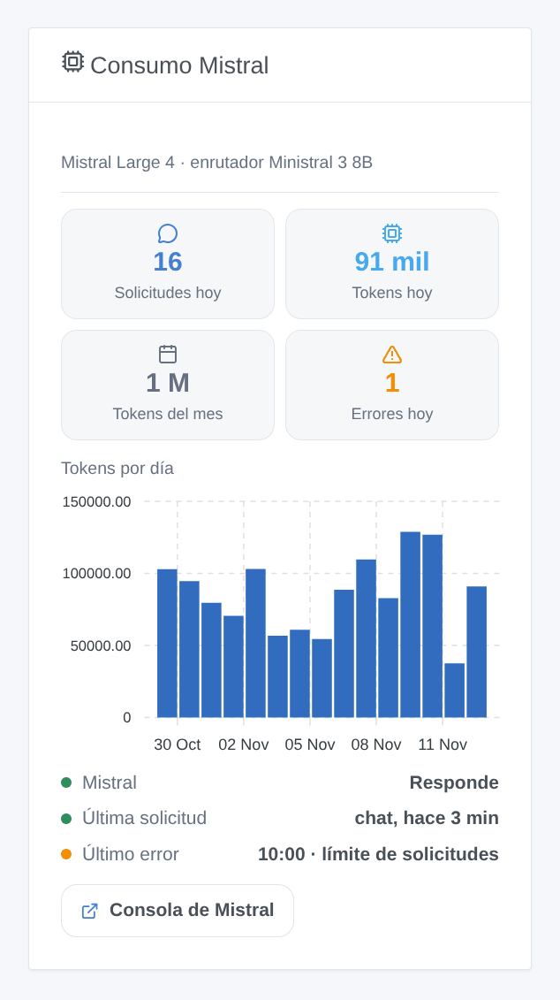

# Mistral AI

## Presentación

Esta integración hace funcionar el asistente de Gladys con **Mistral AI**, la IA francesa, a través de su API oficial (La Plateforme, alojada en Europa) y su propia clave de API. Una vez elegida en **Ajustes → Inteligencia artificial**, cada solicitud de IA de Gladys va a Mistral: el chat y los dispositivos que controla, las escenas que crea, la acción de escena «preguntar a la IA» y el resumen semanal. Funciona con o sin cuenta de Gladys Plus.

También añade una acción de escena que hace una pregunta a Mistral **con búsqueda web**, dos disparadores de escena (el asistente falla, el asistente vuelve a responder) y un widget del panel con su consumo.

Sin relación con Mistral AI. Todavía no probada con una clave real de Mistral: se agradecen los comentarios.

## Requisitos

- Gladys Assistant 5.3.0 o posterior.
- Una cuenta de Mistral y una clave de API: [console.mistral.ai](https://console.mistral.ai/api-keys), **Claves de API** → **Crear una nueva clave**.
- **Plan gratuito Experiment**: una solicitud por segundo aproximadamente y un presupuesto mensual de tokens; Mistral puede usar sus solicitudes para mejorar sus modelos (compruebe los ajustes de privacidad de su organización en la consola). **Plan Scale** (pago por uso): límites más altos, sin entrenamiento con sus datos.
- Lo que sale de su casa: cada mensaje del chat, el historial, las herramientas que ofrece Gladys y sus resultados (el estado de los dispositivos que consulta Mistral) y las imágenes del chat van a Mistral por HTTPS. Las respuestas de Mistral controlan sus dispositivos y crean escenas.

## Configuración

| Campo o botón                             | Por defecto     | Significado                                                                                   |
| ----------------------------------------- | --------------- | --------------------------------------------------------------------------------------------- |
| Clave de API de Mistral                   | —               | Obligatoria. Nunca se vuelve a mostrar ni se registra                                         |
| Modelo del chat                           | Mistral Large 4 | Responde al chat, crea las escenas, redacta el resumen semanal, realiza la búsqueda web       |
| Modelo del enrutador                      | Ministral 3 8B  | Clasifica cada mensaje antes de la respuesta y debe contestar en menos de 20 segundos         |
| Identificador del otro modelo             | —               | Solo si un modelo está en «Otro modelo»: el identificador exacto (debe llamar a herramientas) |
| Razonamiento del modelo del chat          | Medio           | Más razonamiento, mejores escenas, respuestas más lentas                                      |
| Longitud máxima de una respuesta (tokens) | 8000            | Razonamiento incluido                                                                         |
| Probar la conexión                        | —               | Una respuesta corta de cada modelo con su tiempo; consume algunos tokens                      |

El estado de la pantalla de configuración indica si Mistral acepta la clave y los dos modelos, sin consumir tokens, y avisa cuando un modelo no puede llamar a herramientas.

## Uso

1. Integraciones → **Mistral AI** → Configuración: pegue la clave de API, conserve los modelos por defecto, pulse **Probar la conexión**.
2. Ajustes → **Inteligencia artificial**: elija **Mistral AI**.
3. Hable con Gladys en el chat: «enciende el salón», «¿qué temperatura hace en el dormitorio?», «crea una escena que cierre las persianas al atardecer».

### Elegir los modelos

- **Mistral Large 4** (por defecto para el chat): el más capaz, el mejor para crear escenas; siempre razona (bajo, medio o alto).
- **Mistral Small 4**: más rápido y barato; razonamiento desactivado o alto.
- **Ministral 3** (14B, 8B, 3B): pequeños y rápidos, sin razonamiento; Ministral 3 8B es el enrutador por defecto. Son menos fiables para crear escenas.
- **Otro modelo**: un modelo de Mistral más reciente o uno de sus ajustes finos. Si rechaza el parámetro de razonamiento, la integración lo envía sin él a partir de entonces.

### Widget del panel

El widget **Consumo Mistral** muestra las solicitudes y tokens del día, los tokens del mes, los errores del día, los tokens por día durante 30 días, si Mistral responde, la última solicitud y el último error. Cuenta lo que Gladys pidió; la consola de Mistral sigue siendo la referencia para la factura.

### Escenas

- **Acción «Mistral: preguntar con búsqueda web»**: Mistral busca en la web y responde en pocas frases. Campos: la pregunta (se admiten variables de escena), instrucciones adicionales, agencias de noticias (búsqueda premium). Salidas: la respuesta y las fuentes, una por línea.
- **Disparador «Mistral: el asistente falla»**: una vez por fallo (clave rechazada, límite de solicitudes, modelo no disponible, API inaccesible, demasiado lento, error de Mistral), con el tipo, el mensaje, la solicitud y el modelo.
- **Disparador «Mistral: el asistente vuelve a responder»**: la primera respuesta tras un fallo, con los minutos de fallo.

Ejemplos: cada mañana, preguntar con búsqueda web por las noticias del día y enviar la respuesta por Telegram; cuando el asistente falla con una clave rechazada, enviar un SMS al administrador.

## Solución de problemas

- **«Mistral ha rechazado la clave de API»**: vuelva a copiar la clave desde la consola; una clave borrada o caducada da el mismo mensaje.
- **«Se ha alcanzado el límite de solicitudes»**: el plan gratuito acepta una solicitud por segundo aproximadamente. La integración reintenta dentro del tiempo que concede Gladys; si ocurre a menudo, pase al plan Scale o elija un modelo de enrutador más pequeño.
- **«… no está disponible para esta clave de API»**: el modelo no existe o no está abierto a su plan; elija otro.
- **El chat responde sin hacer nada**: puede que el modelo elegido no sepa llamar a herramientas (vea el estado), o que el razonamiento esté desactivado en un modelo pequeño; pruebe Mistral Large 4.
- **«La respuesta se cortó en max_tokens»**: aumente la longitud máxima de una respuesta.
- **Falla una imagen del chat**: puede que el modelo elegido no lea imágenes; los modelos de Mistral de la lista las leen todos.
- Registros: Ajustes → Supervisión, los registros de la integración. No comparta nunca su clave de API.
